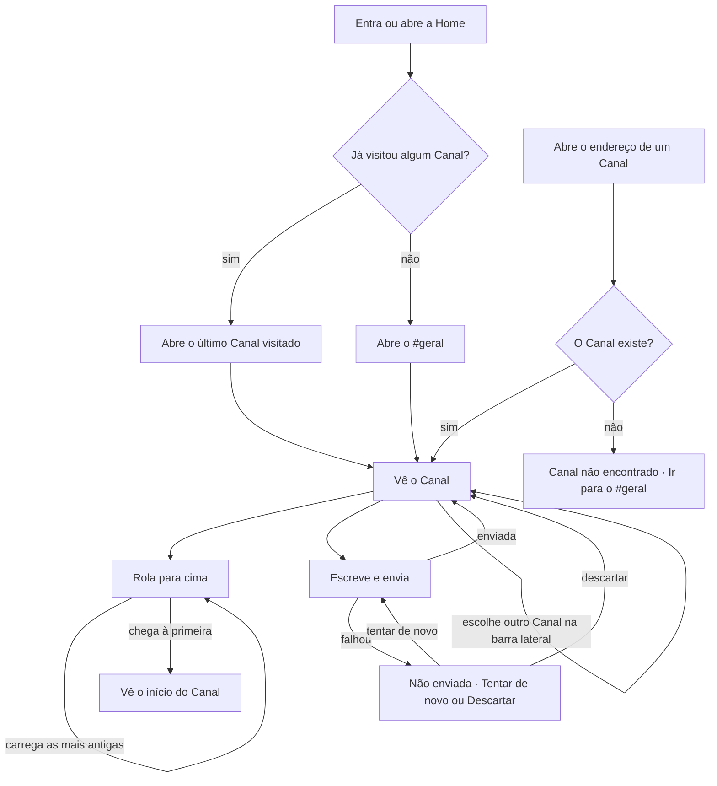

# PRD · F02 · Mensagens em canal público

2026-11-23 · Clenio · Status: rascunho

## 1. Resumo executivo

- **Problema:** depois de entrar (F01), a Pessoa cai numa Home vazia e não consegue conversar com
  ninguém. Sem mensagem não há Conversa, e sem Conversa não há onde mencionar um Agente nem fazer
  um Pedido.
- **Solução proposta:** a Pessoa abre os Canais públicos do Workspace, envia mensagens de texto e
  rola o histórico até a primeira mensagem do Canal.
- **Critérios de sucesso:** esta funcionalidade não move sozinha nenhuma métrica do product brief
  (seção "Objetivos e métricas de sucesso"). Ela é a base da promessa "a IA fica dentro da
  conversa" e destrava as funcionalidades F03 a F14 (roadmap). Ela cumpre parte do item 2 do
  escopo do MVP no brief (conversar nos Canais públicos) e o histórico paginado do item 4.

## 2. Experiência do usuário e funcionamento

### Personas

- **Pessoa do Workspace:** tem uma Conta e uma Sessão (F01). Participa de todos os Canais
  públicos sem precisar entrar neles. Usa o chat no navegador do computador de trabalho.
- **Quem opera a instalação:** cria os Canais públicos por script, junto com as Contas, até a F04
  (Criação de canais) trazer a criação pelo produto.

### Fluxo

### Histórias de usuário

1. Como Pessoa do Workspace, quero ver a lista dos Canais públicos para escolher onde conversar.
2. Como Pessoa do Workspace, quero cair num Canal ao entrar para começar a conversar sem procurar.
3. Como Pessoa do Workspace, quero abrir um Canal por um link para chegar direto a ele.
4. Como Pessoa do Workspace, quero enviar uma mensagem de texto num Canal para falar com as
   pessoas do Workspace.
5. Como Pessoa do Workspace, quero não perder o que escrevi quando o envio falha para tentar de
   novo sem redigitar.
6. Como Pessoa do Workspace, quero ler as mensagens recentes de um Canal e rolar até as mais
   antigas para recuperar o contexto da conversa.

### Critérios de aceite

**História 1, lista de Canais**

- A barra lateral lista todos os Canais públicos do Workspace, em ordem alfabética, com o nome
  precedido de `#`, como na seção da barra lateral do Figma do projeto.
- O Canal aberto aparece destacado na lista.
- Escolher um Canal na lista abre esse Canal sem recarregar a página.
- A lista funciona só pelo teclado: Tab chega a ela, e Enter abre o Canal em foco.

**História 2, Canal ao entrar**

- Ao entrar, ou ao abrir a Home, a Pessoa vê o último Canal que visitou, inclusive vindo de outro
  navegador.
- No primeiro acesso, sem Canal visitado, a Pessoa vê o `#geral`.
- Quem chega por um endereço pedido (PRD da F01, história 4) cai nesse endereço, e não no último
  Canal.

**História 3, endereço do Canal**

- Cada Canal tem um endereço próprio, que muda quando a Pessoa troca de Canal, e o voltar do
  navegador leva ao Canal anterior.
- Abrir o endereço de um Canal que não existe mostra "Canal não encontrado", com um botão para ir
  ao `#geral`.

**História 4, enviar**

- O campo de mensagem segue o design system do projeto: Enter envia e Shift+Enter quebra a linha.
- A mensagem enviada aparece na hora no fim do Canal, com o nome e o avatar de quem enviou e o
  horário, primeiro no estado "enviando" e depois enviada.
- Uma mensagem vazia, ou só com espaços e quebras de linha, não é enviada. Os espaços e as quebras
  das pontas são removidos ao enviar.
- Uma mensagem que passa de 4000 caracteres não é enviada: o campo mostra quanto passou e o envio fica
  desabilitado até ela voltar ao limite.
- O texto aparece como foi escrito, com as quebras de linha, sem formatação. Um endereço web vira
  link e abre numa aba nova.
- As mensagens de outras Pessoas aparecem quando a Pessoa abre ou reabre o Canal, ou recarrega a
  página. A chegada sem recarregar é da F03 (Tempo real).
- Depois de enviar, o campo fica vazio e com o foco, pronto para a próxima mensagem.

**História 5, falha no envio**

- Quando o envio falha por erro do servidor ou da rede, a mensagem fica no Canal marcada como
  "Não enviada", com as ações "Tentar de novo" e "Descartar", como no frame de falha no envio do
  Figma do projeto.
- "Tentar de novo" reenvia a mesma mensagem, que não aparece duplicada para ninguém, mesmo que o
  primeiro envio tenha chegado ao servidor.
- "Descartar" tira a mensagem do Canal.
- Recarregar a página ou trocar de Canal descarta as mensagens não enviadas.

**História 6, histórico**

- Ao abrir um Canal, a Pessoa vê as mensagens mais recentes, com a mais nova embaixo e a
  rolagem no fim.
- Rolar até o topo carrega as mensagens anteriores, sem pular a posição de leitura, até a
  primeira mensagem do Canal, acima da qual aparece o início do Canal (nome e descrição).
- Um Canal sem mensagens mostra só o início do Canal, com um convite para mandar a primeira.
- As mensagens ficam na ordem em que o chat as recebeu, e não na do relógio de quem enviou.
- Um separador marca cada dia: "Hoje", "Ontem" ou a data. Os horários seguem o fuso do navegador
  da Pessoa.
- Mensagens seguidas do mesmo autor, com até 5 minutos entre uma e outra, aparecem agrupadas, sem
  repetir o nome e o avatar, como no layout compacto do design system.
- Enquanto o Canal ou uma página de histórico carrega, a Pessoa vê o estado de carregamento do
  Figma do projeto. Se o carregamento falha, ela vê um erro com "Tentar de novo", e as mensagens
  que já estavam na tela continuam ali.
- A tela segue o design system do projeto e atinge 100 na nota de Acessibilidade do Lighthouse.
  Um leitor de tela anuncia o autor, o horário e o texto de cada mensagem.

### O que não é objetivo

- Ver as mensagens dos outros chegarem sem recarregar, "digitando" e recuperação depois de uma
  queda de conexão: F03 (Tempo real).
- Criar Canais e Canais privados: F04. Na F02, os Canais públicos vêm do script.
- Conversa direta, busca de Pessoas e perfil: F05.
- Menção, Citação, copiar, editar e apagar mensagens: F06. Na F02, um `@nome` é só texto.
- Não lidas e Menções não lidas: F07. Notificações e Atividade: F08.
- Pedidos a Agentes: F10 em diante.
- Formatação (negrito, código, listas), emoji picker, prévia de link, anexos, reações e threads
  (brief, "Fora de escopo").
- Guardar o rascunho do campo de mensagem ao trocar de Canal ou recarregar.
- Busca de mensagens e "pular para a data".
- Nome, descrição e ordem dos Canais definidos pela Pessoa: na F02, eles vêm do script.

## 3. Requisitos do sistema de IA

Não se aplica: a F02 não envolve Agentes.

## 4. Riscos de produto

| Risco | Mitigação |
| --- | --- |
| Sem tempo real, a Pessoa acha que ninguém responde e desiste do chat | A F03 vem logo depois, e a F02 só é demonstrada e usada junto com ela. Reabrir o Canal mostra as novas |
| A Pessoa perde um texto longo quando o envio falha | A mensagem fica no Canal como "Não enviada", com "Tentar de novo", sem perder o texto |
| Um novo envio depois de uma falha duplica a mensagem para todos | "Tentar de novo" não cria uma segunda mensagem, mesmo se o primeiro envio chegou |
| Um Canal com anos de histórico demora a abrir | O Canal abre só com as mensagens recentes e carrega as antigas ao rolar |
| Mensagens fora de ordem confundem a conversa quando os relógios dos computadores divergem | A ordem é a de chegada ao chat, e não a do relógio de quem enviou |
| A instalação sobe sem nenhum Canal, e a Pessoa vê uma tela vazia | O script da instalação cria pelo menos o `#geral`, que é o Canal do primeiro acesso |
